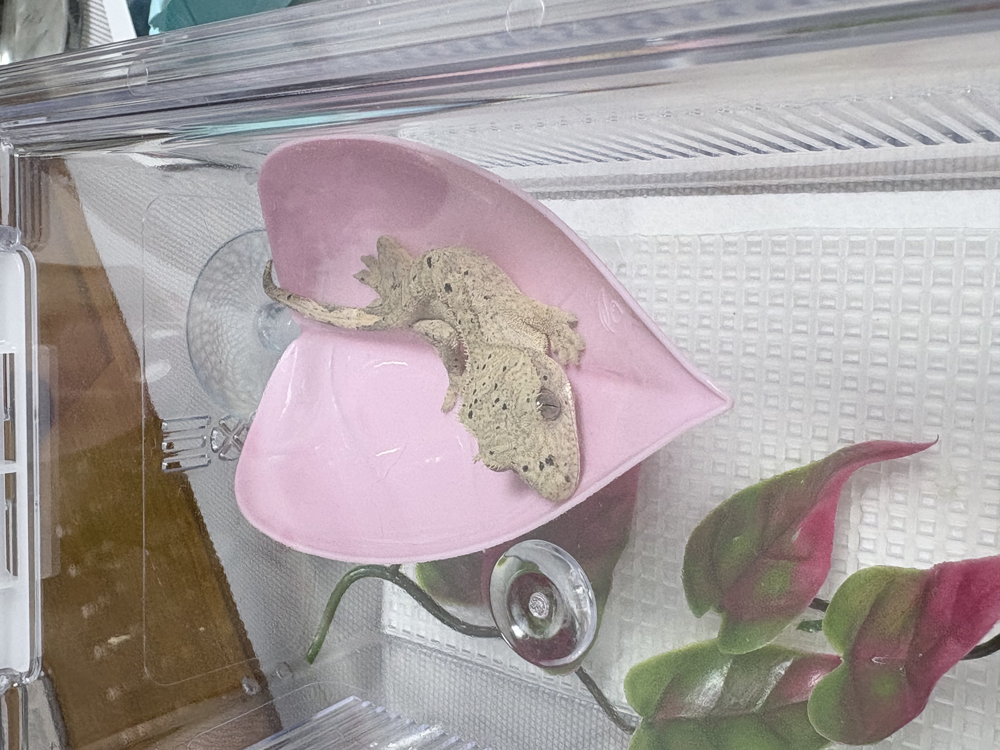
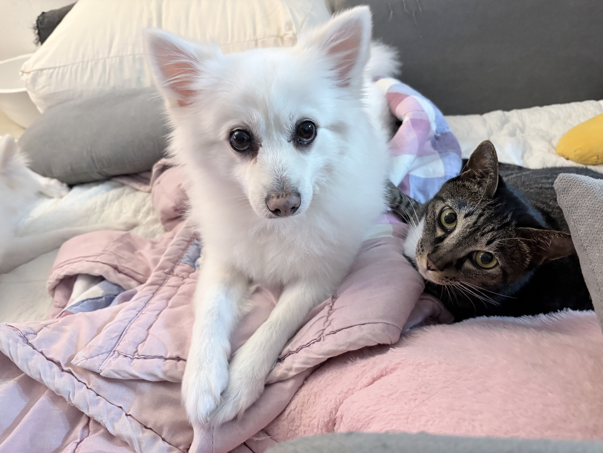
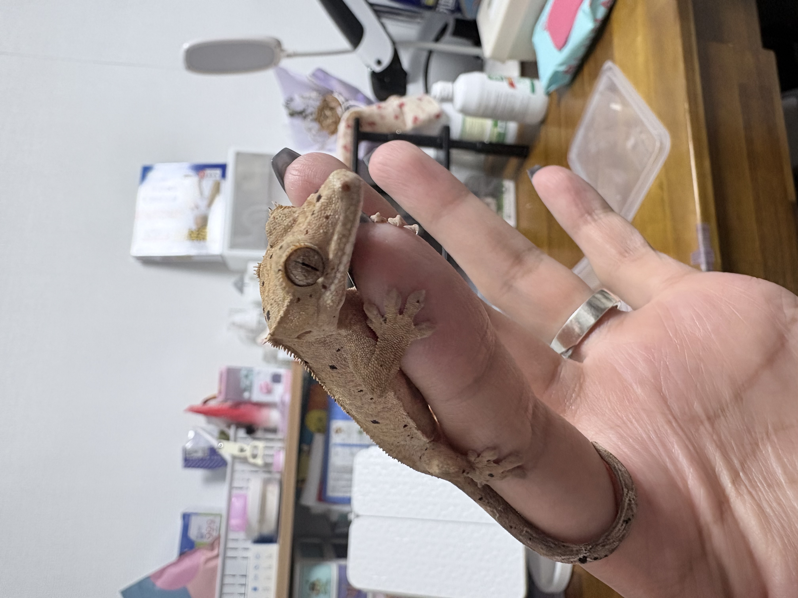
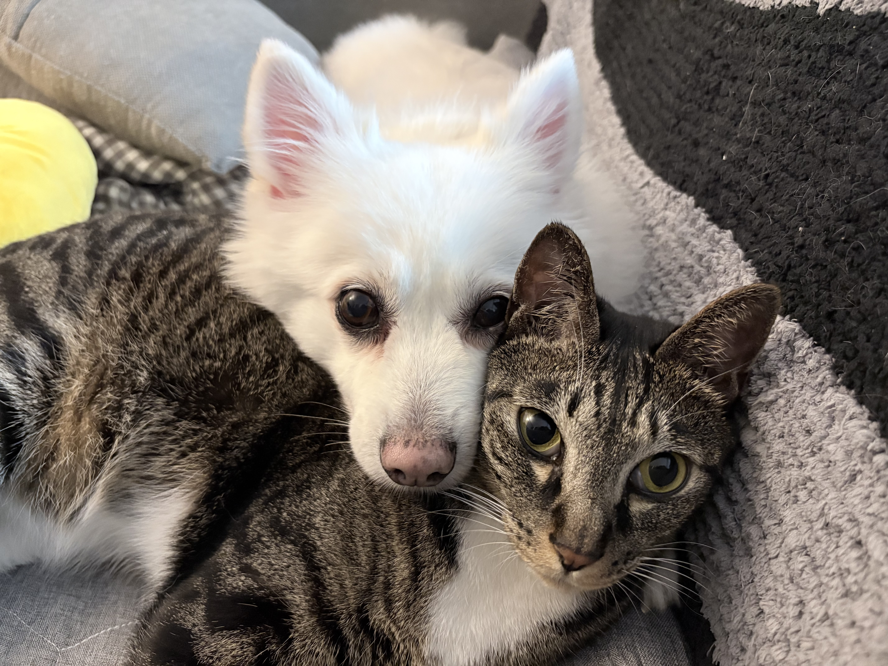
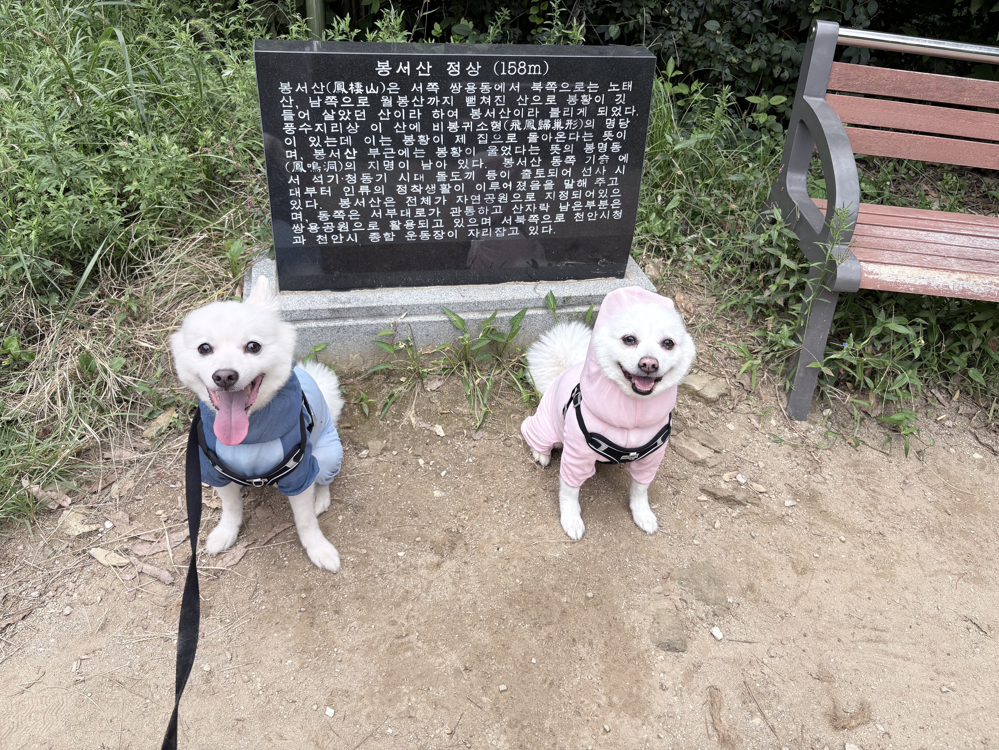
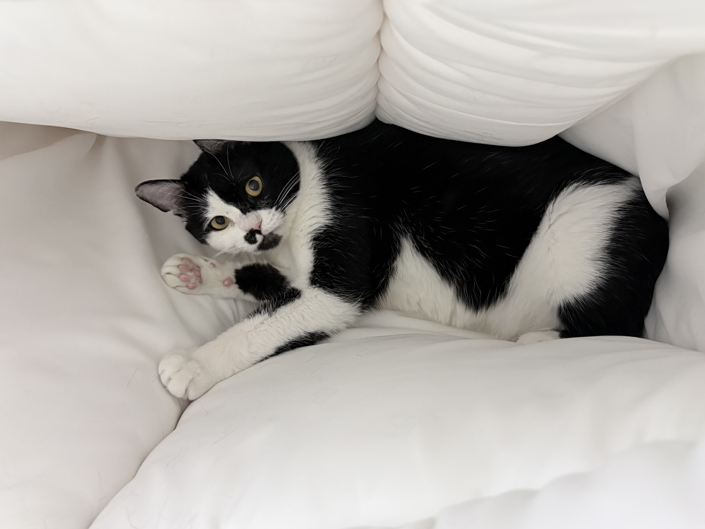

# 👋 안녕하세요! FT 황혜현입니다.

앞으로 데브코스 과정에서 여러분과 함께할 FT입니다!

개발을 공부하다 보면 어렵거나 막막한 순간도 있겠지만,
너무 조급해하지 않고 각자의 속도로 꾸준히 성장하셨으면 좋겠습니다.

학습이나 교육 과정 중 어려운 점이 있다면
언제든 편하게 말씀해 주세요. 😊

---

## 🔍 About Me

- 💻 직업 : 웹 개발자
- 🧩 MBTI : ISTP
- 🐾 반려동물 : 고양이, 강아지, 도마뱀

## 💬 소소한 TMI

- 고양이, 강아지, 도마뱀과 함께 살고 있습니다.

## 🐾 저희 집 가족들을 소개합니다!

  
  
  

  
  
  

고양이, 강아지, 도마뱀과 함께 살고 있습니다!
동물 이야기는 언제든 환영입니다. 🐾

- 동물 이야기는 언제든 환영입니다!

---

## 🌱 수강생 여러분께

개발 공부는 단거리 달리기가 아닌 마라톤이라고 생각합니다.

모든 것을 한 번에 이해하려고 하기보다는
하루하루 조금씩 성장하는 것에 집중하셨으면 좋겠습니다.

> 완벽하지 않아도 괜찮습니다.
> 꾸준히 나아가는 것이 중요하니까요!

**과정이 끝나는 날까지 즐겁게 함께해요.
앞으로 잘 부탁드립니다! 🙌**
